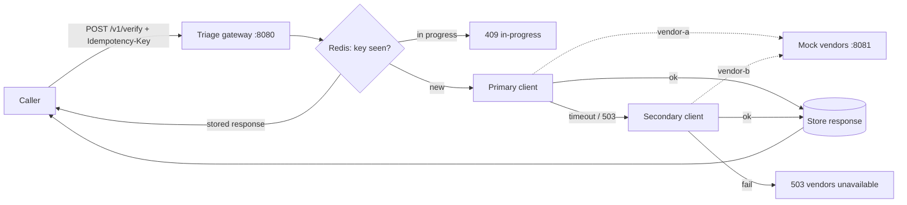

# Triage

Third-party verification APIs fail, time out and rate-limit. Triage sits between a caller and two vendors, retries only what is safe to retry, trips a circuit breaker on a failing vendor, falls back to a second vendor, and makes repeated requests with the same `Idempotency-Key` call a vendor only once.

## Request flow



## Run it

```bash
docker compose up -d                       # Redis on 6379
cd mock-vendors && mvn spring-boot:run     # :8081
cd triage-gateway && mvn spring-boot:run   # :8080
```

Try the failure path. Turn on 100% errors on vendor A, send requests, then check the circuit:

```bash
curl -X PUT localhost:8081/chaos/vendor-a -H 'Content-Type: application/json' \
  -d '{"latencyMs":0,"errorPercent":100,"forceTimeout":false}'

curl -X POST localhost:8080/v1/verify -H 'Idempotency-Key: k1' -H 'Content-Type: application/json' -d '{"customer":"42"}'
# -> 200, vendor "secondary", fromFallback true

curl localhost:8080/actuator/circuitbreakers   # primary circuit OPEN after enough failures
```

Reset with `errorPercent: 0`. Use `forceTimeout: true` to simulate a hung vendor. Use `latencyMs` above 2000 to trigger the timeout.

Run tests with `mvn test` in each module. Redis tests need Docker and are skipped without it.

## Design decisions

- **Decorator order.** Each vendor call is wrapped with TimeLimiter, Retry and CircuitBreaker, configured in `application.yml`. Spring's resilience4j aspects apply Retry outermost, so every retry attempt is recorded by the circuit breaker. Each attempt has a 2s timeout.
- **Retry policy.** Retry only on timeouts and 503. Max 3 attempts with exponential backoff (200ms, x2) and jitter. A 4xx is never retried; it counts as a rejection and is ignored by the circuit breaker.
- **Fallback.** If the primary fails after retries or its circuit is open, the secondary is called. If both fail, the caller gets `503 ALL_VENDORS_UNAVAILABLE`.
- **Idempotency.** The first request claims the key in Redis with `SET NX` (`IN_PROGRESS`, 60s). When it completes, the response is stored for 24h. A duplicate gets the stored response with no vendor call. A concurrent duplicate, arriving while the claim is held, gets `409 IDEMPOTENCY_IN_PROGRESS`. If the call fails, the claim is released so the client can retry.
- **Logging.** Each vendor call logs vendor, latency and outcome. No audit table.
